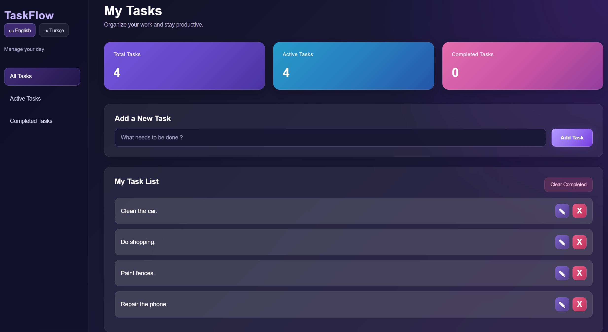
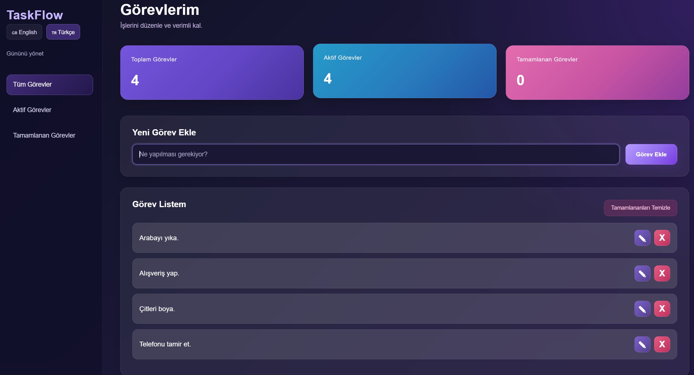
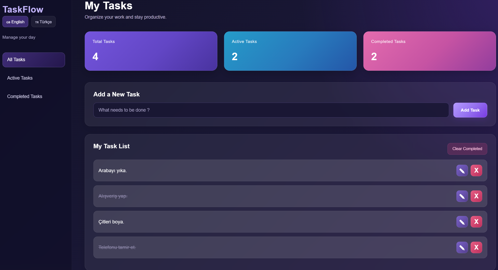
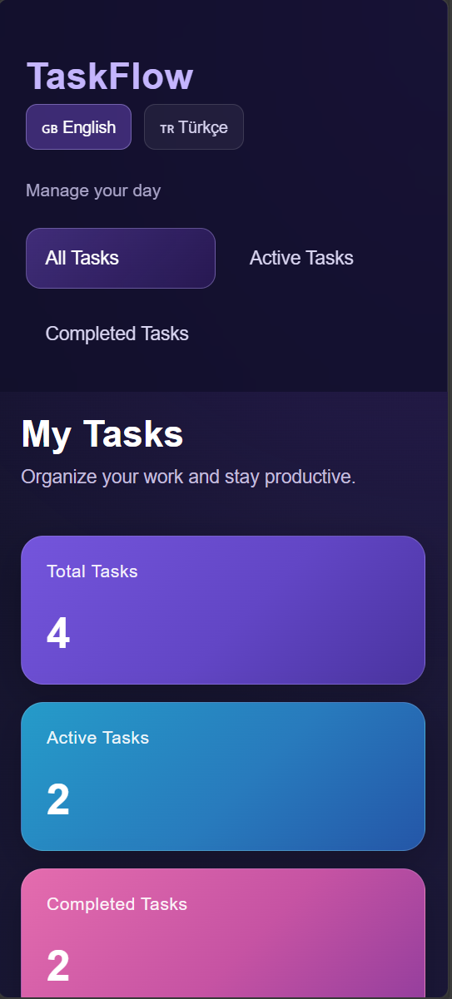
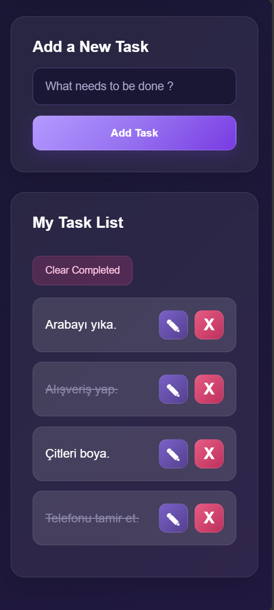

# TaskFlow – Task Management App

TaskFlow is a responsive task management application built with HTML, CSS, and Vanilla JavaScript. It helps users organize their daily tasks through a simple and user-friendly interface.

The application supports both English and Turkish.

## Live Demo

[Open TaskFlow](https://mertozan1.github.io/taskFlow/)

## Features

- Add new tasks
- Edit existing tasks
- Delete tasks
- Mark tasks as completed or active
- Filter tasks by All, Active, and Completed
- View total, active, and completed task counts
- Clear all completed tasks
- Switch between English and Turkish
- Save tasks using Local Storage
- Restore tasks after refreshing the page
- Responsive design for different screen sizes

## Technologies Used

- HTML5
- CSS3
- JavaScript (Vanilla JavaScript)
- DOM Manipulation
- Local Storage

## Screenshots

### English Interface

### Turkish Interface

### Task Management

### Responsive Design – Top Section

### Responsive Design – Tasks Section

## Installation

1. Clone the repository:

   `git clone https://github.com/MertOzan1/taskFlow.git`

2. Open the project folder.

3. Open `index.html` in your browser.

## Author

**Mert Özan**

GitHub: [@MertOzan1](https://github.com/MertOzan1)
